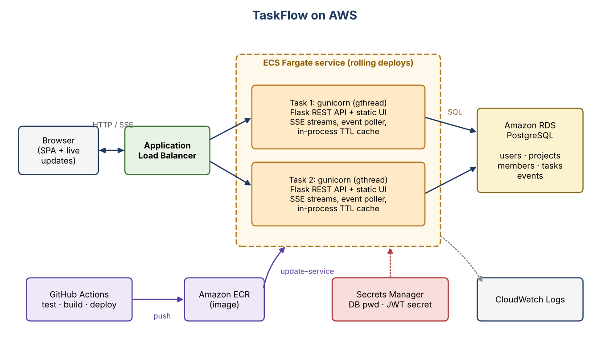
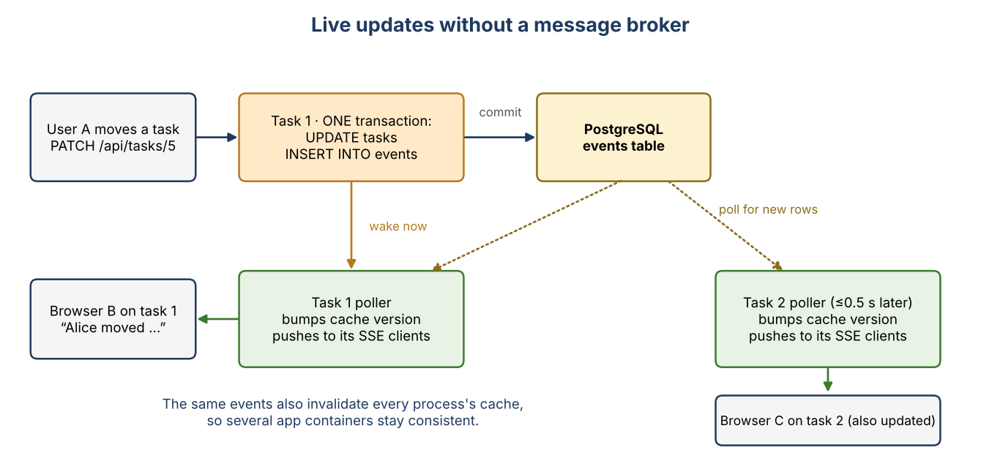

# TaskFlow: Cloud-Native Task Management Platform

A full-stack task management app with **role-based access control**, **live dashboards**, **real-time updates**,
**paginated and cached REST APIs** on **PostgreSQL**, packaged with **Docker**, deployed to **AWS** (ECS Fargate + RDS)
by a **CI/CD pipeline**. Python/Flask back end, dependency-free JavaScript front end.

> **Status.** Back end, tests, front end, Docker, CI/CD and Terraform are all included.
> The back end and its 52 tests were run on SQLite. The same code and tests are set up to run on PostgreSQL in CI.
> Load-test results and the real AWS deployment are **yours to run**: see [Load testing](#load-testing) and
> [AWS deployment](#aws-deployment). The UI was syntax-checked but not clicked through in a browser while this repo was prepared.



## Features
| Area | What you get |
|---|---|
| Access control | Global roles (`admin`, `member`) plus per-project roles (`owner`, `manager`, `member`, `viewer`), enforced on the server for every endpoint |
| Dashboards | Per-project dashboard (status and priority breakdown, overdue, unassigned, workload, 7-day completion chart) and a personal cross-project dashboard |
| Real time | Task and member changes appear instantly in other users' browsers (Server-Sent Events), with automatic reconnect and replay of missed events |
| REST API | Pagination, filtering (status, priority, assignee, text search, overdue), whitelisted sorting, consistent JSON errors |
| Caching | Server-side TTL cache with version-based invalidation, plus `ETag` / `304 Not Modified` so unchanged lists cost almost nothing |
| Packaging | One small Docker image (non-root), `docker compose up` for local, Postgres in a container |
| CI/CD | GitHub Actions: tests on SQLite **and** PostgreSQL, container smoke test, then deploy to ECS with automatic rollback |
| Infrastructure | Terraform: ECR, ECS Fargate, ALB, RDS PostgreSQL, Secrets Manager, CloudWatch, optional HTTPS and GitHub OIDC deploy role |

## Roles and permissions
Non-members get `404` (a project's existence is not revealed). Members who lack a permission get `403`.

| Permission | viewer | member | manager | owner | admin (global) |
|---|:--:|:--:|:--:|:--:|:--:|
| Read project, tasks, dashboard, members | ✓ | ✓ | ✓ | ✓ | ✓ |
| Create tasks | | ✓ | ✓ | ✓ | ✓ |
| Edit tasks they created or are assigned to | | ✓ | ✓ | ✓ | ✓ |
| Edit any task | | | ✓ | ✓ | ✓ |
| Assign tasks to others, unassign | | self only | ✓ | ✓ | ✓ |
| Delete tasks | | | ✓ | ✓ | ✓ |
| Rename or delete project, manage members | | | | ✓ | ✓ |
| List users, change global roles | | | | | ✓ |

The role is read from the database on every request, so removing someone takes effect immediately, not when their token expires.

## Run it locally
```bash
docker compose up --build            # app on http://localhost:8000, Postgres inside Docker
```
Sign in with a demo account (password `demo-pass-123`): `alice@demo.local` (owner), `bob@demo.local` (manager),
`carol@demo.local` (member), `dave@demo.local` (viewer). Admin: `admin@taskflow.local` / `admin-change-me-123`.

**See real time working across servers:** `docker compose --profile scale up --build` starts a second app container on
http://localhost:8001. Open both in two browsers, sign in as different users, move a task on one: it updates on the other.

Without Docker (SQLite):
```bash
pip install -r requirements.txt
SEED_DEMO=true python -m app.initdb
flask --app "app:create_app" run --port 8000        # or: gunicorn 'app:create_app()' -k gthread --threads 100
```

## API overview
Auth header: `Authorization: Bearer <token>`. Errors look like `{"error": {"code": "forbidden", "message": "..."}}`.

| Method | Path | Notes |
|---|---|---|
| POST | `/api/auth/register`, `/api/auth/login` | returns `{token, expires_in, user}` |
| GET | `/api/auth/me` | current user |
| GET/POST | `/api/projects` | list mine (paginated) / create (creator becomes owner) |
| GET/PATCH/DELETE | `/api/projects/{id}` | |
| GET/POST/PUT/DELETE | `/api/projects/{id}/members[/{userId}]` | owner/admin only for changes |
| GET | `/api/projects/{id}/tasks` | `page, page_size (max 100), status, priority, assignee (id/me/none), q, overdue, sort` |
| POST | `/api/projects/{id}/tasks` | |
| GET/PATCH/DELETE | `/api/tasks/{id}` | |
| GET | `/api/projects/{id}/dashboard`, `/api/dashboard` | project and personal dashboards |
| POST | `/api/auth/stream-token` | 60-second token for the live stream |
| GET | `/api/stream?token=…` | Server-Sent Events |
| GET | `/api/users`, `/api/admin/stats` · PUT `/api/users/{id}/role` | admin only |
| GET | `/healthz` | load balancer health check |

## How the main parts work
**Pagination.** `LIMIT/OFFSET` with a total count, a hard cap of 100 per page, and indexes on `(project_id, status)`,
`(project_id, assignee_id)` and `(project_id, id)`. Sort columns come from a whitelist, so a client cannot inject SQL.

**Caching.** Each project has a version number. Cached lists and dashboards include it in their key, so one write makes
all old entries for that project unreachable. The `ETag` is built from the same version, so a repeat request with
`If-None-Match` returns `304` before any database query. Permissions are checked first, so a `304` never leaks data.

**Real time.** Every write inserts a row into an `events` table in the *same transaction* as the change. Each app process
runs one small poller that reads new rows (every 0.5 s, or immediately when it did the write itself), bumps cache
versions, and pushes the event to its connected browsers over SSE. Because the database is the shared channel, it works
with several workers or containers and needs no Redis or message broker.



**Security.** scrypt password hashing; short-lived JWTs (HS256) with a separate 60-second token type for the event stream
(browsers cannot send headers on `EventSource`); parameterised SQL only; no `innerHTML` in the UI; CSP and other security
headers; the app refuses to start in production without a strong `JWT_SECRET`; secrets come from AWS Secrets Manager.

## Tests
```bash
python -m unittest discover -s tests -t . -v                  # SQLite, 52 tests
TEST_DATABASE_URL=postgresql://user:pw@localhost/db python -m unittest discover -s tests -t . -v   # PostgreSQL
```
Covered: auth (expired, forged and wrong-type tokens), the full permission matrix, pagination, filters, sorting, LIKE-wildcard
escaping, injection attempts, cache invalidation, ETag/304, cross-process cache invalidation (two app instances on one database),
event delivery rules, a **live SSE connection over a real HTTP server** (including reconnect replay and disconnect cleanup),
parallel-startup safety, and config handling.

## Load testing
`loadtest/loadtest.py` needs only Python. It creates a project and N users, then simulates realistic traffic
(list/filter/paginate, dashboards, ETag revalidation, task updates and creation) and can hold extra live-update connections open.
```bash
python loadtest/loadtest.py --base http://<your-alb-or-localhost> --users 300 --duration 120 --sse 100 --json result.json
```
Run it from a machine other than the server, increase `--users` in steps, and note the server size (for example 2 Fargate tasks × 0.5 vCPU, `db.t4g.micro`).
Record **your** results here (and only claim what you measured):

| Users | Duration | Req/s | p50 (ms) | p95 (ms) | p99 (ms) | Error rate | Notes |
|---|---|---|---|---|---|---|---|
| _fill in_ | | | | | | | |

## CI/CD
`.github/workflows/ci.yml`: every push and pull request runs the tests on SQLite and PostgreSQL, checks the front-end syntax,
builds the image and smoke-tests the container. On `main` (when `DEPLOY_ENABLED=true`) it pushes the image to ECR and rolls out
to ECS, waiting until the service is stable. ECS's deployment circuit breaker rolls back a failing release automatically.
If you want to state how much faster releases became, measure it yourself (for example, time from merge to production before
and after this pipeline).

## AWS deployment
Everything below is provided as Terraform in `infra/terraform` but was **not applied** while preparing this repo. Expect to fix small details on first apply. Cost: an ALB, 2 Fargate tasks and a `db.t4g.micro` run a few dollars per day; run `terraform destroy` when done.
```bash
cd infra/terraform
terraform init
terraform apply -target=aws_ecr_repository.app            # 1) create the image repository first
# 2) build and push the first image (commands: ECR console > "View push commands")
terraform apply -var github_repo=<you>/<repo> [-var certificate_arn=<ACM ARN>]   # 3) everything else
```
Then in your GitHub repo set **Variables** `DEPLOY_ENABLED=true`, `AWS_REGION`, `ECR_REPOSITORY`, `ECS_CLUSTER`, `ECS_SERVICE`
(values are in `terraform output`) and **Secret** `AWS_ROLE_ARN` (output `github_deploy_role_arn`). The generated admin password is in
Secrets Manager (`terraform output admin_password_secret`). **Add an ACM certificate** (`certificate_arn`) before real use, otherwise passwords and tokens travel over plain HTTP.

## Design decisions and limitations
- **SQLite for dev and tests, PostgreSQL for production.** One thin database layer serves both; the CI job proves the PostgreSQL path.
- **Events through the database** keep the stack small. Above a few thousand concurrent live connections you would move to Redis pub/sub or PostgreSQL `LISTEN/NOTIFY`.
- **Each live connection uses one server thread** (gunicorn `gthread`); size `GUNICORN_THREADS` and task count to the number of concurrent users.
- Offset pagination gets slower on very deep pages; keyset pagination is the upgrade.
- Schema is created by a small script. Use Alembic migrations for real releases.
- Tokens live in `sessionStorage`; a production system would use httpOnly cookies plus CSRF protection.
- No email, file attachments, comments, or audit log yet.

## Layout
```
app/              Flask API (routes/, rbac.py, cache.py, events.py, db.py, schema.py, security.py)
frontend/         index.html, app.js, styles.css (no build step)
tests/            52 tests (unittest)
loadtest/         loadtest.py
infra/terraform/  AWS infrastructure
.github/workflows/ci.yml
Dockerfile, docker-compose.yml, scripts/seed_demo.py, docs/
```
